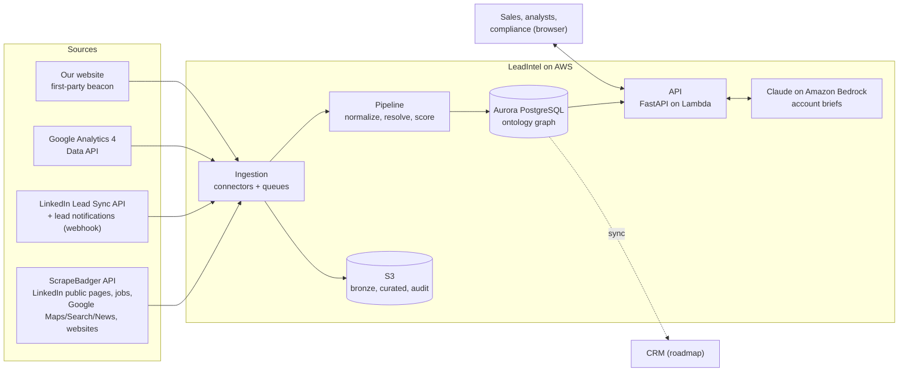
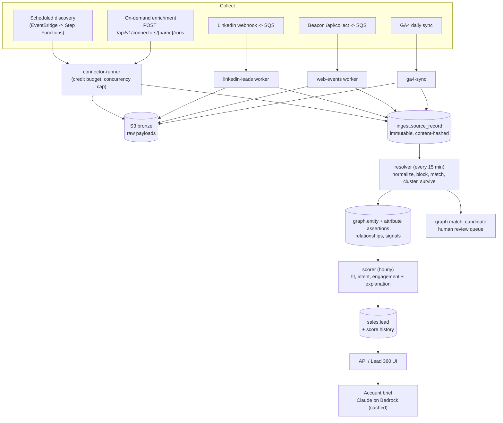
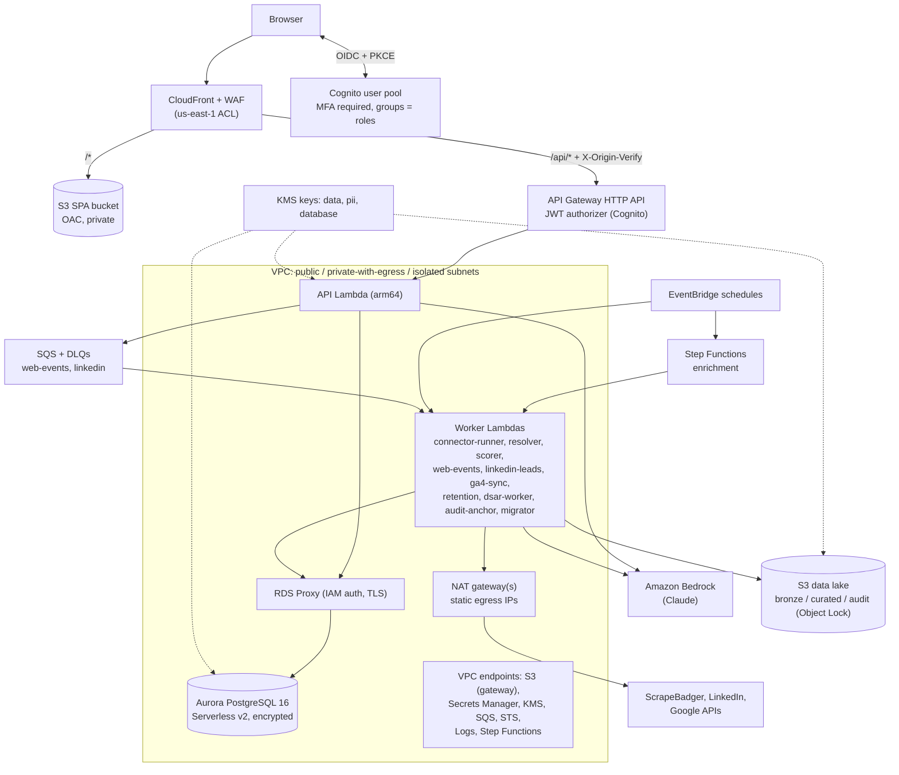

# LeadIntel architecture

LeadIntel is a B2B lead-intelligence platform on AWS. It collects company and
buyer signals from ScrapeBadger (LinkedIn company pages, jobs, Google Maps,
Search and News, company websites), LinkedIn Lead Gen Forms, Google Analytics 4
and our own website. It stitches them into one graph of organizations and people
in which every value carries its provenance. It then scores leads in a way the
sales team can audit, and serves a "360-degree" view of each lead with an
optional AI-written account brief.

This document is the end-to-end plan: what the system does, how data moves, how
it is deployed and secured, what it costs, and how it is delivered. The deep
dives live next to it:

| Document | What it covers |
| --- | --- |
| [ONTOLOGY.md](ONTOLOGY.md) | Object, link and signal types, provenance, survivorship, lineage |
| [DATA_SOURCES.md](DATA_SOURCES.md) | Every connector: access, data obtained, limits, failure modes, how to add one |
| [SECURITY.md](SECURITY.md) | Threat model and controls, layer by layer; deployment trust |
| [COMPLIANCE.md](COMPLIANCE.md) | GDPR/CCPA posture, processing register, retention, DSARs, scraping policy |
| [RUNBOOK.md](RUNBOOK.md) | Day-2 operations: deploys, alarms, restores, rotations, incidents |
| [ROADMAP.md](ROADMAP.md) | Delivery phases with exit criteria |
| [adr/](adr/README.md) | Architecture decision records |

## 1. Goals and non-goals

**Goals**

1. **One trustworthy picture per account.** Merge every source into golden
   records for organizations and people. Each attribute keeps its source,
   observation time, confidence and the competing values it beat.
2. **Explainable prioritization.** Rank leads by fit, intent and engagement.
   Every point of a score is attributed to a factor a salesperson can read.
3. **Privacy and security by design.** Personal data is minimized, encrypted at
   field level, scoped by territory in the database itself, retained only as
   long as policy allows, and erasable on request. Every sensitive action is
   audited in a tamper-evident log.
4. **Cheap to run, simple to operate.** It is serverless and pay-per-use, with
   one command to deploy an environment and one to tear it down.
5. **Modular.** Sources, scoring and presentation evolve independently behind
   stable contracts.

**Non-goals (for now)**

- Outbound automation (sequencing, auto-emailing). LeadIntel informs humans. It
  does not contact people.
- Scraping behind logins or circumventing access controls. See
  [COMPLIANCE.md](COMPLIANCE.md#scraping-policy).
- Being the CRM. The CRM stays the system of record for opportunities. LeadIntel
  feeds it (see the roadmap).

## 2. Architecture principles

| Principle | Consequence in the design |
| --- | --- |
| Provenance over convenience | Raw responses are kept (bronze zone). Source records are immutable and content-hashed. Golden values carry `source`, `observed_at`, `record_id` and `confidence`. |
| Deterministic, replayable pipeline | Source record ids are UUIDv5 of `(source, external_id)`, so re-ingesting is idempotent. Resolution and scoring can be re-run from source records at any time. |
| The database enforces policy | Territory scoping is PostgreSQL row-level security, not application `WHERE` clauses. The audit log is append-only by privilege and trigger. Merges go through one `SECURITY DEFINER` function. |
| Least data, least privilege | Contact fields are encrypted, with blind indexes for lookups. Roles see masked data unless they hold `pii:read`. Each Lambda has its own role and database login. |
| Anti-corruption layers at every edge | Third-party SDK models never leak past `connectors/`. Everything inside speaks the ontology (`ontology/models.py`). |
| Humans decide the uncertain cases | Matches between the review and auto-merge thresholds go to a review queue. They are never merged automatically. |
| Everything as code | Infrastructure (CDK), schema (versioned migrations), policies (retention seeds), ICP (`config/icp.json`) and tests all live in this repo. |

## 3. System context



## 4. The ontology: a "Palantir-style" view of a lead

LeadIntel models the market as an **ontology** rather than as rows of contacts,
in the spirit of Palantir Foundry's Ontology (no affiliation or dependency):

- **Objects**: `Organization` and `Person` entities, each with a golden record.
- **Properties with provenance**: each property holds the surviving value plus
  where and when it was observed, how many sources agree, and the alternatives
  it beat.
- **Links**: typed relationships (`works_at`, `subsidiary_of`,
  `uses_technology`, ...), each with its own provenance and confidence.
- **Time series**: **signals** (job postings, funding, pricing-page views, form
  fills, ...) attached to entities and decayed over time.
- **Lineage**: every entity lists the source records that resolved to it, with
  the match method, probability and log-odds evidence.
- **Actions**: changing lead status, merging entities, suppressing a contact,
  answering a DSAR and generating a brief. Each one is permission-checked and
  audited.

The Lead 360 page is this ontology rendered for one lead: the score and why,
the contact with masking and consent, the brief, the signal timeline, the
relationship graph and the golden records with provenance. Details:
[ONTOLOGY.md](ONTOLOGY.md).

## 5. Data flow



### 5.1 Collect

Connectors implement one protocol (`connectors/base.py`): `run(playbook,
params, ctx) -> FetchBatch`. The run context carries a **credit budget**
(`CreditBudget`) and a concurrency cap. A run that would exceed its budget stops
cleanly and records what it spent. The ScrapeBadger connector exposes
**playbooks**, which are compositions of SDK calls with a business purpose:

| Playbook | What it does |
| --- | --- |
| `market_hiring_scan` | LinkedIn job search for roles we sell into: hiring signals plus the hiring companies |
| `company_profile` | LinkedIn company page: firmographics, specialties, HQ, size |
| `website_enrichment` | Company website: description, technologies, contact pages (SSRF-guarded) |
| `news_triggers` | Google News: funding, acquisitions, expansion, leadership changes |
| `local_discovery` | Google Maps search: local businesses, phone, address, ratings |
| `account_research` | The above, chained for one account |
| `person_profile` | Public LinkedIn profile. **Off by default**, gated by `allow_person_profile_scraping` and legal sign-off |

The other sources: LinkedIn Lead Sync (webhook-notified, then fetched through
the API), GA4 (a daily `runReport` keyed by the `lead_visitor_id` user
dimension) and the first-party beacon (consent-aware page events). See
[DATA_SOURCES.md](DATA_SOURCES.md).

### 5.2 Land

Raw upstream responses go to the **bronze** S3 zone (KMS-encrypted, 30-day
lifecycle in production), so mappings can be fixed and replayed without paying
for the calls again. Each normalized observation becomes an
`ingest.source_record`:

- Its id is `uuid5(source, external_id)`, so the same observation is never
  stored twice.
- It is stamped with a content hash, the lawful basis, and the observation and
  fetch times.

### 5.3 Normalize

`pipeline/normalize.py` canonicalizes domains (public-suffix aware), emails,
E.164 phone numbers, LinkedIn URLs and slugs, company names (legal suffixes
dropped) and job titles to seniority. Identifiers become **blocking keys**.
Person keys are HMAC blind indexes, so raw emails are never used as join keys.
Organization keys are plain (domains are not personal data).

### 5.4 Resolve

Entity resolution (`pipeline/resolution/`) runs in four steps:

1. **Blocking** finds candidate entities that share any key.
2. **Matching** scores each candidate Fellegi-Sunter style. Every comparable
   feature (domain, name similarity, LinkedIn slug, phone, city, title, ...)
   adds or subtracts log-odds. The result is a probability plus an ordered
   evidence list. Exclusive identifiers (two different LinkedIn slugs) veto a
   match.
3. **Clustering** uses a constrained union-find:
   - At or above **0.95** the record joins the entity.
   - Between **0.70 and 0.95** the pair goes to the **review queue**.
   - Below 0.70 the record seeds a new entity.
   - Two existing entities are never merged automatically. That is a human
     decision, made through `graph.merge_entities`.
4. **Survivorship** picks each attribute's golden value by source trust ×
   recency (365-day half-life), with a bonus when sources agree. Losing values
   are kept as alternatives.

### 5.5 Score

`pipeline/scoring.py` computes three components, each 0-100:

| Component | What it measures |
| --- | --- |
| Fit | Industry, size, geography, technology, persona against `config/icp.json` |
| Intent | Market signals: hiring, funding, expansion, leadership change, news, technology |
| Engagement | Our own touchpoints: visits, pricing page, downloads, forms, meetings |

The scoring rules:

- Signals decay exponentially, with a half-life per type.
- Repeated signals of one type have diminishing returns.
- Components saturate, so volume cannot buy rank.
- `total = 0.45 fit + 0.35 intent + 0.20 engagement`.
- Tiers: **A >= 70, B >= 50, C >= 30**, otherwise D.
- A lead is **hot** after a form fill, pricing-page view or meeting in the last
  72 hours.
- Leads are assigned to a territory by HQ country.
- Every contribution is stored as the lead's explanation, and each score is kept
  in the score history.

### 5.6 Serve

The API (FastAPI on Lambda, behind API Gateway and CloudFront) serves:

- the ranked worklist
- the Lead 360 view
- entity lineage and the relationship graph (1-2 hops)
- search
- the review queue
- privacy operations (suppression, DSARs)
- the audit trail and its verification
- on-demand connector runs

Account briefs come from Claude on Amazon Bedrock:

- Only firmographics, scored signals and the person's title and seniority are
  sent. Contact details never are.
- Scraped text is fenced as untrusted data.
- The JSON comes back through a validated tool call.
- Results are cached per input fingerprint.

## 6. AWS deployment view



Stacks (`infra/leadintel_infra/stacks/`), named `leadintel-<env>-<unit>`:

| Stack | Contents |
| --- | --- |
| `network` | VPC with three subnet tiers, NAT, flow logs, endpoints, Lambda security group |
| `security` | KMS keys (data, pii), secrets, Cognito user pool, groups and SPA client; account guardrails (CloudTrail, GuardDuty, Security Hub) where enabled |
| `data` | Aurora cluster and its KMS key, RDS Proxy, login users, S3 bronze/curated/audit/logs buckets, Athena workgroup |
| `ingestion` | Queues and DLQs, worker Lambdas, the enrichment state machine, schedules |
| `api` | API Lambda, HTTP API with JWT authorizer, throttling, access logs |
| `edge` | WAF web ACL for CloudFront (always us-east-1) |
| `web` | CloudFront distribution, SPA bucket, security headers/CSP, runtime `config.json` |
| `observability` | Dashboard, alarms to SNS email, monthly budget |
| `cicd` | GitHub OIDC provider and a deploy role limited to the CDK bootstrap roles |

Scripts wrap the whole lifecycle (`scripts/aws/`):

| Script | Purpose |
| --- | --- |
| `bootstrap.sh` | Prepare the account once |
| `setup.sh` | Build, deploy, store secrets, migrate, seed and create the first admin. Idempotent |
| `status.sh` | Show the deployment state of an environment |
| `rotate-secrets.sh` | Rotate a platform secret |
| `teardown.sh` | Snapshot first, typed confirmation for protected environments, `--dry-run` |

## 7. Codebase and dependency rules

```
leadgen/
  src/leadintel/
    core/         settings, errors, ids, structured logging
    ontology/     entity, attribute, signal and provenance models (no I/O)
    security/     envelope crypto, blind indexes, RBAC, audit chain, secrets,
                  SSRF guard, log redaction, webhook signatures, JWT verification
    connectors/   ScrapeBadger gateway + mappers + playbooks, LinkedIn Lead Sync,
                  GA4, first-party events; registry
    pipeline/     normalize, ICP, resolution/, scoring, service, Lambda handlers
    compliance/   consent, DSAR, retention
    storage/      connections, migration runner, raw store, repositories
    api/          FastAPI app, routers, middleware, Lambda adapter
    ai/           account briefs (Claude on Bedrock)
    devtools/     synthetic demo dataset
  database/       migrations, seeds, local Postgres, backup/restore scripts
  infra/          CDK app, stacks, constructs, per-environment config
  scripts/        aws/ (bootstrap, setup, status, rotate, teardown), build/, dev/
  web/            React SPA (Vite, TypeScript), unit + browser tests
  tests/          unit, contract, integration, infra, scripts
  config/         icp.json
  docs/           this documentation
```

Dependency direction:

- `ontology` and `core` depend on nothing internal.
- `security` depends on `core`.
- `connectors` map external models to `ontology` and never import `pipeline`,
  `storage` or `api`.
- `pipeline` orchestrates `connectors` and `storage`.
- `api` is the only HTTP surface and nothing imports it.

A new source is therefore one module plus contract tests (see
[DATA_SOURCES.md](DATA_SOURCES.md#adding-a-source)).

## 8. Security architecture (summary)

Defence in depth, detailed in [SECURITY.md](SECURITY.md):

| Layer | Controls |
| --- | --- |
| Edge | CloudFront with TLS 1.2+ (custom domain); WAF with IP-reputation, common, known-bad-inputs and SQLi rule groups plus rate limits; strict CSP and security headers; one origin for SPA and API |
| Identity | Cognito with MFA required; Hosted UI with PKCE; groups map to roles; API Gateway JWT authorizer plus in-app verification (access tokens only, client id pinned) |
| Origin | API rejects requests without the CloudFront `X-Origin-Verify` secret; private SPA bucket via OAC |
| Authorization | RBAC permissions per route; territory row-level security in PostgreSQL; PII masked unless `pii:read`; denials audited |
| Data | KMS envelope encryption of contact fields with an encryption context; HMAC blind indexes; Aurora, S3, logs and secrets encrypted with customer-managed keys |
| Network | Isolated database subnets; RDS Proxy with IAM auth and TLS; VPC endpoints; static NAT egress IPs for vendor allowlists; SSRF guard on outbound fetches |
| Audit | Hash-chained append-only `audit.audit_log`, verified by SQL and Python, anchored hourly to S3 Object Lock |
| Supply chain | Locked dependencies (`uv.lock`, `package-lock.json`); GitHub OIDC (no long-lived keys); CDK approval for security-group/IAM broadening in production |

## 9. Privacy by design (summary)

Every source record carries its lawful basis. Highlights from
[COMPLIANCE.md](COMPLIANCE.md):

- A **consent ledger** records consent by purpose.
- A **suppression list** (blind-indexed) is checked before any person record is
  stored.
- **DSARs** (access, erasure, ...) have jurisdictional due dates and an approval
  step.
- A **nightly retention job** applies the schedule in `privacy.retention_policy`.
- Person-profile scraping is **disabled** until legal signs off.

## 10. Reliability and operations

**Idempotency and replay**

- Deterministic ids mean every stage can be retried.
- Queues have dead-letter queues (5 receives).
- The state machine retries rate limits and retryable connector errors, and
  isolates task failures.
- Batch handlers report partial failures.

**Connections**

- Lambda containers outlive server-side connections: RDS Proxy closes clients
  idle for 15 minutes, and failovers drop everything. Cached connections idle
  for over a minute are pinged before reuse (never mid-transaction), so the
  first request or scheduled run after a quiet spell does not fail.
- `/api/readyz` answers 503 when the database is unreachable instead of
  erroring.

**Concurrency**

- The scorer, retention and DSAR workers run with a concurrency of one.
- Connector concurrency is capped per run and in the state machine (two tasks in
  parallel).

**Backups**

- Aurora keeps continuous backups with point-in-time recovery: 1 day in dev,
  30 days in production.
- Manual snapshots: `database/scripts/backup.sh`.
- Restores create a new cluster: `database/scripts/restore.sh`.

**Recovery targets.** RPO 5 minutes (PITR) and RTO under 2 hours in production;
both are verified by the restore drill in the runbook.

**Observability**

- Structured JSON logs carry a request id and redaction.
- Metrics are emitted as EMF.
- Alarms fire on:
  - DLQ depth
  - errors from each worker and the API
  - failed enrichment executions
  - API 5xx responses
  - Aurora approaching its maximum ACUs
  - daily ScrapeBadger credit burn
- A monthly AWS budget alert backs these up.

The runbook maps each alarm to an action.

## 11. Scalability

| Dimension | How it scales | First limit to watch |
| --- | --- | --- |
| API traffic | Lambda concurrency; HTTP API throttles (50 rps dev / 200 rps prod); CloudFront | Aurora connections, hence RDS Proxy pooling |
| Ingestion volume | SQS batching; Lambda concurrency per worker; Step Functions Map | ScrapeBadger credits and rate limits (budgets, 429 backoff) |
| Database | Aurora Serverless v2 ACUs (0-4 dev, 1-32 prod) plus a reader in prod | Resolution on very large blocks. Keys are selective by design (domain, LinkedIn slug, blind-indexed email/phone); add a block-size cap if a key degenerates |
| Graph queries | Indexed adjacency in PostgreSQL; neighbourhoods limited to 2 hops | Analytical graph workloads: export the curated zone to Athena, or to Neptune if needed |
| Analytics | Curated S3 zone queried with Athena; masked BI view (`sales.v_lead_bi`) | None in practice |

PostgreSQL is the graph store: a sales graph is millions of edges at most, not
billions, and keeping it relational gives transactions, RLS and joins with leads
([ADR 0002](adr/0002-aurora-postgresql-as-graph-store.md)).

## 12. Environments and delivery

| Setting | dev | staging | prod |
| --- | --- | --- | --- |
| AZs / NAT gateways | 2 / 1 | 2 / 1 | 3 / 3 |
| Aurora ACUs, reader | 0-4 (auto-pause), none | 0.5-8, none | 1-32, one reader |
| Backups | 1 day | 7 days | 30 days, deletion protection |
| Audit Object Lock | governance, 1 day | governance, 30 days | compliance, 7 years |
| Log retention | 14 days | 30 days | 365 days |
| AI briefs | off | on | on |
| Account guardrails | off | off | CloudTrail, GuardDuty, Security Hub |

A change moves through these steps:

1. **Pull request.** CI (`.github/workflows/leadgen-ci.yml`) runs lint, type
   checks, unit, contract, integration (PostgreSQL 16 service) and script tests,
   CDK synthesis with posture assertions, and the web unit and browser tests.
2. **Deploy.** `scripts/aws/setup.sh --env <env>`, locally or from CI through the
   OIDC deploy role:
   - CDK deploys every stack.
   - Secrets are stored from the operator's shell.
   - The migrator Lambda applies migrations inside the VPC (with checksum drift
     detection and an advisory lock).
   - Seeds are applied idempotently.
3. **Production.** IAM or security-group broadening needs human approval
   (`--require-approval broadening`).

## 13. Cost model

These are estimated monthly costs at us-east-1 list prices as of October 2026,
excluding taxes and free tiers unless noted. Treat them as orders of magnitude
and check the AWS Pricing Calculator before committing.

**Development** (1 NAT, 2 AZs, Aurora auto-pause, AI off):

| Item | Basis | USD / month |
| --- | --- | --- |
| Interface VPC endpoints | 6 services × 2 AZs × $0.01/h | ~88 |
| RDS Proxy | billed for a minimum of 8 ACUs × $0.015/h, even when the cluster is idle | ~88 |
| NAT gateway | 1 × $0.045/h + $0.045/GB | ~35 |
| Aurora Serverless v2 | ~100 active ACU-hours × $0.12 + storage | 10-20 |
| WAF | $5 per ACL + 6 rules + requests | ~11 |
| CloudWatch | logs, VPC flow logs, metrics, alarms | 10-20 |
| KMS (3 keys), Secrets Manager (~8) | | ~6 |
| Lambda, API Gateway, SQS, Step Functions, EventBridge, S3, CloudFront, Cognito | low volume, mostly free tier | < 10 |
| **Total** | | **≈ 250-280** |

**Production** (3 NAT, 3 AZs, writer and reader, guardrails on, briefs on):

| Item | Basis | USD / month |
| --- | --- | --- |
| Aurora writer + reader | 2-ACU floor ($175) up to ~5 ACUs average in business hours | 175-450 |
| Interface VPC endpoints | 6 × 3 AZs × $7.30 | ~131 |
| NAT gateways | 3 × $32.85 + data processing | 100-120 |
| RDS Proxy | 8-ACU minimum, or the database's ACUs when higher | 88-180 |
| CloudWatch | 365-day log retention, flow logs, dashboards | 40-120 |
| CloudTrail, GuardDuty, Security Hub | | 30-100 |
| Lambda | including 2 provisioned API instances | 20-50 |
| WAF, API Gateway, CloudFront, S3, Athena, KMS, Secrets, Cognito | | 30-60 |
| **AWS total** | | **≈ 650-1,200** |
| Claude account briefs | e.g. 2,000 fresh briefs × (~6k input + ~2k output tokens) at the Claude API list price of $4 / $20 per MTok for Opus 5.5 is about $0.06 each. Bedrock pricing is set by AWS: check the Bedrock pricing page (regional endpoints can cost more). Cached briefs are free | ~130 |
| ScrapeBadger | Credit-based. Subscriptions are published from $49 to $699 a month, and pay-as-you-go credits do not expire. The daily discovery budget is 600 credits in prod config | plan dependent |

**Cost levers**, in order of impact:

1. **Drop RDS Proxy in dev.** Connect Lambdas straight to the cluster with IAM
   auth, saving ~$88.
2. **Remove interface endpoints in dev and staging** and route through NAT. This
   saves ~$88 per environment and pays off below ~200 GB/month per service.
3. **One NAT gateway in staging.** Production keeps one per AZ for availability.
4. **Lower log retention, and sample VPC flow logs** (`REJECT` only) outside
   production.
5. **Tune ScrapeBadger budgets** (`scrapebadger_run_credit_budget`, per-task
   `credit_budget`). Failed requests are not charged.
6. **Brief caching and effort.** Briefs are cached per input fingerprint. Lower
   `ai_effort` for shorter outputs.

The `observability` stack sets a monthly AWS Budget per environment ($300 dev,
$600 staging, $2,500 prod). It alerts at 80% of actual spend and at 100% of
forecast spend.

## 14. Delivery plan

| Phase | Outcome | Exit criteria |
| --- | --- | --- |
| 0. Foundation (this repo) | Modular codebase, schema, security model, CDK stacks, scripts, UI, tests | CI green; `make demo` end to end; dev deploys and tears down cleanly |
| 1. Pilot (6 weeks) | Dev and staging live with ScrapeBadger, beacon and GA4; 2-3 reps using the worklist | ≥ 70% of A-tier leads judged worth working by reps; review queue cleared weekly; cost per qualified lead tracked |
| 2. Production (6 weeks) | Prod with custom domain, pen test, DPIA sign-off, LinkedIn Lead Sync, CRM sync | Restore drill passed; alarms routed to on-call; DSAR SLA met in a dry run |
| 3. Intelligence (quarter 2) | Outcome feedback loop, calibrated weights, lookalike accounts (pgvector), BI | Measurable lift in conversion of A/B tiers vs. pilot baseline |
| 4. Scale | Multi-tenant, SAML SSO, EU data residency, zero-downtime secret rotation, BFF auth | Driven by customer demand |

Details: [ROADMAP.md](ROADMAP.md).

## 15. Key decisions

| ADR | Decision |
| --- | --- |
| [0001](adr/0001-serverless-first.md) | Serverless first: Lambda, SQS, Step Functions, Aurora Serverless v2 |
| [0002](adr/0002-aurora-postgresql-as-graph-store.md) | Aurora PostgreSQL as system of record and graph store |
| [0003](adr/0003-ontology-with-provenance.md) | Ontology with per-attribute provenance and survivorship |
| [0004](adr/0004-probabilistic-entity-resolution.md) | Probabilistic entity resolution with a human review queue |
| [0005](adr/0005-scrapebadger-behind-anti-corruption-layer.md) | ScrapeBadger as the first source, behind an anti-corruption layer; LinkedIn person data only via official APIs by default |
| [0006](adr/0006-field-level-encryption-and-blind-indexes.md) | Field-level envelope encryption with blind indexes |
| [0007](adr/0007-row-level-security-for-territories.md) | Territory scoping enforced by PostgreSQL row-level security |
| [0008](adr/0008-claude-on-bedrock-for-briefs.md) | Claude on Amazon Bedrock for account briefs |
| [0009](adr/0009-spa-auth-pkce-single-origin.md) | Single CloudFront origin; SPA with Cognito PKCE |
| [0010](adr/0010-cdk-in-python.md) | AWS CDK in Python for infrastructure |

## 16. Risks

| Risk | Likelihood | Impact | Mitigation |
| --- | --- | --- | --- |
| Source terms or anti-bot changes break scraping | Medium | Medium | Anti-corruption layer; budgets; contract tests on recorded fixtures; multiple sources per attribute; official APIs preferred |
| Legal exposure from personal-data scraping | Medium | High | Person scraping off by default; lawful basis per record; suppression and DSAR tooling; retention; DPIA before enabling |
| Wrong merges corrupt the graph | Low | High | Conservative thresholds, exclusive identifiers, no automatic entity-entity merges, review queue, lineage to undo |
| Score gaming or opacity erodes trust | Medium | Medium | Saturation and diminishing returns; per-factor explanation; outcome-based calibration (phase 3) |
| PII leak via logs or the AI prompt | Low | High | Redaction filter; encrypted fields; brief input excludes contact data; prompt-injection fencing |
| Cost creep (proxy, endpoints, credits) | Medium | Low | Budgets and alarms; levers in section 13; credit budgets per run |
| Vendor lock-in | Low | Medium | Ontology and connector contracts isolate vendors; PostgreSQL and S3 are portable |
