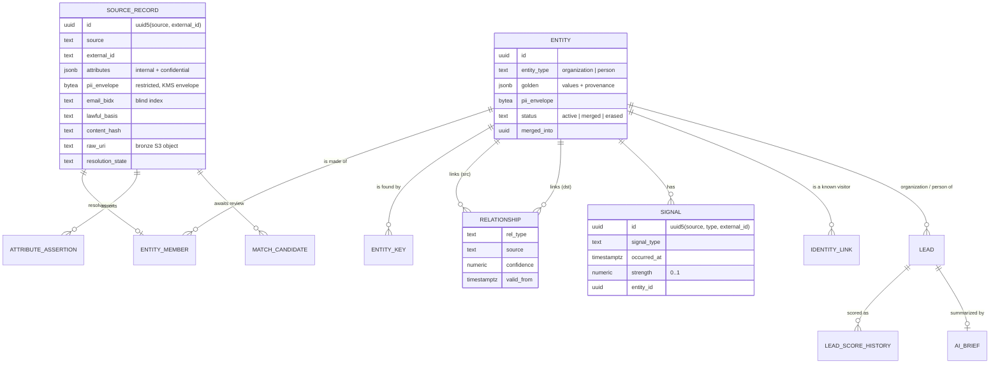

# Ontology

The ontology is the shared language of LeadIntel. Connectors translate vendor
data into it. The pipeline resolves and scores in it. The API and UI present
it. The code lives in `src/leadintel/ontology/` (models and attribute
classification) and `database/migrations/V0002`-`V0004` (storage).

## Model at a glance



## Object types

| Type | Identity keys used for blocking | Typical sources |
| --- | --- | --- |
| `organization` | `domain:<registrable domain>`, `li_org:<company slug>`, `gplace:<place id>`, `orgphone:<E.164>`, `orgname:<normalized name>` | ScrapeBadger LinkedIn company, jobs, Maps, website, news; Lead Sync and website forms (company name, email domain) |
| `person` | `email:`, `phone:`, `li:` (profile slug), `name_domain:` and `name_company:` (name + employer). All are HMAC blind indexes, never raw identifiers | LinkedIn Lead Sync (self-reported), website forms, ScrapeBadger person profile (gated) |

Entities never disappear silently:

- A merged entity keeps `status = 'merged'` and points at its survivor through
  `merged_into`. Old links keep resolving.
- An erased person (DSAR) keeps `status = 'erased'` with its personal attributes
  removed. This preserves referential integrity without retaining the data.

## Attributes and data classification

Canonical attribute names are defined in `ontology/attributes.py`. Every
attribute has a data class, which decides how it is stored and who sees it:

| Class | Organization attributes | Person attributes | Storage | Visible to |
| --- | --- | --- | --- | --- |
| internal | name, domain, website, linkedin_slug, linkedin_url, google_place_id, industry, description, specialties, categories, employee_count, employee_range, founded_year, follower_count, hq_city, hq_region, hq_country, address, phone (switchboard), rating, review_count, technologies | - | `golden` JSON | every role with `entities:read` |
| confidential | - | full_name, first_name, last_name, title, seniority, headline, linkedin_slug, linkedin_url, city, region, country, company_name, company_domain | `golden` JSON (RLS-scoped) | `entities:read` within scope |
| restricted | - | email, phone (personal) | KMS envelope in `pii_envelope`; HMAC blind index for lookups | decrypted only for `pii:read`, audited; masked for everyone else |

Restricted values exist in plaintext only in memory. `SourceRecord.restricted`
is envelope-encrypted before persistence, with an encryption context (tenant,
purpose, application) bound into both the KMS call and the ciphertext. See
[SECURITY.md](SECURITY.md#field-level-encryption).

## Golden records and provenance

`graph.entity.golden` holds one entry per attribute:

```json
{
  "industry": {
    "value": "Software Development",
    "confidence": 0.93,
    "agreeing_sources": 2,
    "provenance": {
      "source": "scrapebadger.linkedin.company",
      "source_record_id": "8f0c...",
      "observed_at": "2026-09-25T10:12:00Z"
    },
    "alternatives": [
      {
        "value": "IT Services",
        "provenance": {"source": "scrapebadger.google.maps", "observed_at": "2026-08-01T00:00:00Z"}
      }
    ]
  }
}
```

Every non-restricted value any source ever asserted is also kept in
`graph.attribute_assertion` (record, attribute, value, observed time). That
supports "what did we believe on date X" and lets survivorship be recomputed
under new rules.

### Survivorship

For each attribute, every candidate value gets a score. The highest score wins.

```
score = trust(source, attribute) x 0.5 ^ (age_days / 365) + 0.1 x (agreeing distinct sources - 1)
```

Source trust (`pipeline/resolution/survivorship.py`): self-reported data beats
scraped data, and specific sources beat generic ones.

| Source | Trust | Attribute-specific bonus |
| --- | --- | --- |
| `manual` | 1.00 | |
| `linkedin.lead_sync` | 0.95 | |
| `first_party.web`, `crm` | 0.90 | |
| `scrapebadger.linkedin.company` | 0.85 | +0.15 employee count/range, +0.10 industry |
| `scrapebadger.linkedin.profile` | 0.80 | +0.10 title |
| `scrapebadger.web` | 0.75 | +0.30 technologies, +0.10 description |
| `scrapebadger.google.maps` | 0.70 | +0.25 phone, +0.20 address, +0.30 rating/review count |
| `scrapebadger.linkedin.jobs` | 0.60 | |
| `scrapebadger.google.news`, `scrapebadger.google.serp` | 0.50 | |

The winning value's confidence is reported, and losing values are kept as
`alternatives` (shown in the UI under "other values").

## Relationships (links)

`graph.relationship` holds typed edges, each with `source`, `confidence`,
optional `valid_from`/`valid_to` and free-form `properties` (for example a job
title on `works_at`).

| Type | From | To | Typical evidence |
| --- | --- | --- | --- |
| `works_at` | person | organization | Lead form company, profile experience, email domain |
| `worked_at` | person | organization | Profile history |
| `alumni_of` | person | organization (school) | Profile education |
| `uses_technology` | organization | organization (vendor) | Website technology detection |
| `mentioned_in` | organization | organization | News co-mentions |
| `subsidiary_of` | organization | organization | Company pages, websites |
| `competitor_of` | organization | organization | Analyst input (manual) |

Connectors emit relationships as `RelationshipAssertion`s that name their
endpoints by **hints** (domain, slug, name). The resolver turns hints into
entity ids once both ends exist.

## Signals (time series)

A signal is a dated event about an entity, with a strength from 0 to 1. Its id
is `uuid5(source, type, external_id)`, so re-ingesting never double counts.

| Signal | Component | Base points | Half-life (days) | Makes a lead hot (72 h) |
| --- | --- | --- | --- | --- |
| `job_posting` | intent | 18 | 30 | |
| `funding` | intent | 30 | 90 | |
| `acquisition` | intent | 15 | 90 | |
| `expansion` | intent | 18 | 60 | |
| `leadership_change` | intent | 20 | 90 | |
| `news_mention` | intent | 5 | 30 | |
| `tech_detected` | intent | 8 | 180 | |
| `web_visit` | engagement | 10 | 14 | |
| `high_intent_page` | engagement | 25 | 14 | yes |
| `content_download` | engagement | 20 | 30 | |
| `form_submission` | engagement | 45 | 45 | yes |
| `email_click` | engagement | 12 | 14 | |
| `meeting_booked` | engagement | 60 | 60 | yes |

Signals arrive with a `subject_hint` (domain, slug, visitor id). Unresolved
signals wait in `graph.signal` with `entity_id IS NULL` until the resolver links
them.

## Identity graph

Anonymous website visitors carry a first-party `lead_visitor_id`. The same id
is sent to GA4 as a user-scoped custom dimension. When a visitor identifies
themselves (form submission, email click, login, CRM match),
`graph.identity_link` ties the visitor id to the person entity. Their past and
future web signals then attach to that person and their organization.

## Lineage and the review loop

Every entity can answer "where did this come from":

- `graph.entity_member` lists each member source record with `method` (`seed`,
  `deterministic`, `probabilistic`, `manual`), `match_probability`, the
  log-odds `evidence` (feature, weight, detail) and who decided.
- `ingest.source_record` points back to the raw upstream payload in S3
  (`raw_uri`) and records the lawful basis.

Uncertain matches (probability between 0.70 and 0.95) create a
`graph.match_candidate`. The record keeps a provisional entity of its own until
a human with `entities:merge` decides in the review queue:

- **Accept** calls `graph.merge_entities(loser, survivor, actor)`. This one
  `SECURITY DEFINER` function moves members, keys, relationships, signals,
  identity links and leads to the survivor, de-duplicating as it goes. It marks
  the loser as merged and flags the survivor's golden record for recomputation.
- **Reject** records the decision so the same pair is not proposed again.

Both outcomes are written to the audit log.

## Leads

A lead is `(organization, optional person)`. It belongs to a territory (from
HQ country) and optionally to an owner. Scoring writes:

- `score`, `fit_score`, `intent_score`, `engagement_score`, `tier` and `hot`
- `score_explanation`: a list of `{component, factor, points, detail}`, the
  "why this score" in the UI
- a row in `sales.lead_score_history`

Account-level leads (no person yet) and person-level leads coexist for the same
organization, so an account can be worked before a contact is known.

## Extending the ontology

1. Add the attribute to `ontology/attributes.py` with its data class.
   Restricted attributes need encryption, so review [SECURITY.md](SECURITY.md)
   first.
2. Map it in the relevant connector mapper and add a contract-test fixture.
3. Add a trust bonus in survivorship if a source is authoritative for it.
4. If it feeds scoring, extend `pipeline/icp.py` or `SIGNAL_POLICY` and update
   this document.
5. New relationship or signal types also need the `CHECK` constraints extended
   in a new migration (never edit an applied migration).
